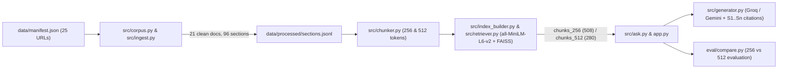
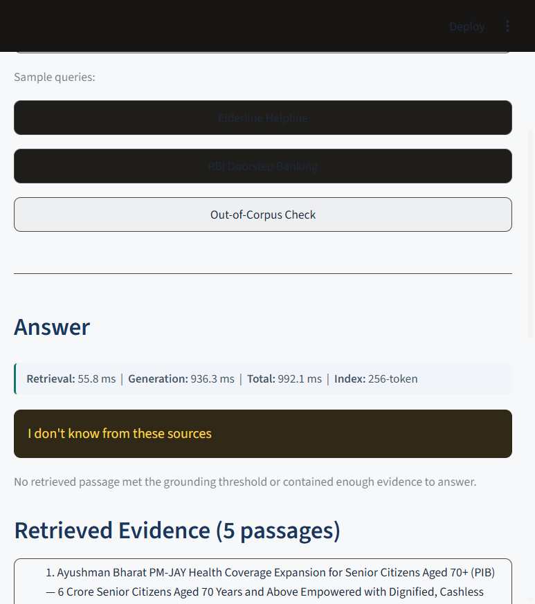

# Kedara — Ask-a-Care-Resource RAG Pipeline

A grounded Retrieval-Augmented Generation (RAG) CLI system for answering questions about official Indian senior-citizen welfare schemes, statutory rights, healthcare, pensions, taxation, and banking services.

---

## Project Purpose

Senior citizens and caregivers in India often have to navigate fragmented government portals (DoSJE, PIB, RBI, Income Tax, EPFO) to find reliable information on pensions, helplines, legal rights, and health coverage. Kedara provides a transparent, source-grounded question-answering pipeline that:
1. Retrieves relevant passages from an official 24-document Indian government corpus.
2. Answers strictly from retrieved evidence with inline `[S1]`..`[Sn]` citations mapped to exact chunk and source URL provenance.
3. Explicitly refuses (`"I don't know from these sources"`) when evidence is missing or below similarity threshold, rather than hallucinating.

---

## Architecture



- **`config/settings.py`**: Central paths, retrieval defaults (`all-MiniLM-L6-v2`, `256` / `512`-token chunks, `32`-token overlap, `top_k=5`, `cl100k_base` tokenizer), and LLM provider configuration (`groq` or `gemini`, `temperature=0.0`).
- **`src/ingest.py` & `src/corpus.py`**: Manifest validation (`data/manifest.json`), HTTP fetching with retries/exponential backoff, HTML (`BeautifulSoup` + `lxml`) and PDF (`pypdf`) section extraction, boilerplate stripping, section deduplication, and snapshot persistence (`data/processed/sections.jsonl` & `data/processed/ingestion_report.json`).
- **`src/chunker.py`**: Deterministic `tiktoken` (`cl100k_base`) token-bounded chunking with overlap and unique chunk IDs (`{doc_id}__c{size}__{idx:04d}`).
- **`src/retriever.py` & `src/index_builder.py`**: L2-normalized `sentence-transformers` embeddings (`384`-D) indexed in FAISS (`IndexFlatL2`) with cosine similarity scoring and dual-index building (`chunks_256` and `chunks_512`).
- **`src/generator.py` & `src/ask.py`**: Grounded answering with `[S1]`..`[Sn]` handle resolution, single constrained retry on citation formatting errors, strict refusal handling, failure categorization, and CLI entrypoint.
- **`app.py`**: Minimal Streamlit "Care Resource Explorer" UI reusing the cached `SentenceTransformerEmbedder`, FAISS `VectorStore`, and `generate_grounded_answer()` modules.
- **`eval/`**: Schema-validated evaluation runner (`eval/run_eval.py`), Recall@5 / MRR@5 / refusal / failure-breakdown / human-reviewed citation metrics (`eval/metrics.py`), controlled `256` vs `512` comparison (`eval/compare.py`), and authoring guide (`eval/AUTHORING_GUIDE.md`).

---

## Dependencies

Key packages (pinned in `requirements.txt`):
- **Retrieval & Embeddings**: `faiss-cpu==1.15.0`, `sentence-transformers==5.6.0`, `huggingface-hub>=1.5.0,<2.0`, `numpy==2.4.6`, `tiktoken==0.14.0`
- **Ingestion**: `pypdf==6.16.2`, `beautifulsoup4==4.15.0`, `lxml==6.1.3`, `requests==2.33.0`
- **LLM Providers**: `groq==1.0.0`, `google-genai==1.65.0`
- **Config & Testing**: `python-dotenv==1.2.2`, `pytest==9.1.1`

---

## Installation & Run Commands

### Option A: Docker (Recommended, Python 3.11)

1. Copy `.env.example` to `.env` and set your `GROQ_API_KEY` or `GEMINI_API_KEY`.
2. Build the image and both FAISS indexes from the committed `data/processed/sections.jsonl` snapshot:

```powershell
docker build --network=host -t kedara-rag:py311 .
docker run --rm --network=host -v "${PWD}:/app" kedara-rag:py311 python -m src.index_builder
```

> **First-Time Downloads & Offline Cache Setup**:
> - **Online (default)**: On first run, `tiktoken` downloads `cl100k_base.tiktoken` from `openaipublic.blob.core.windows.net` (into `/tmp/data-gym-cache`), and `sentence-transformers` downloads `all-MiniLM-L6-v2` from Hugging Face Hub (into `~/.cache/huggingface`). Both are excluded from Git (no model weights or unverified-redistribution tokenizer blobs are committed).
> - **Offline / Restricted Networks (Windows PowerShell)**: Mount your existing host caches read-only and set `HF_HUB_OFFLINE=1`:
>   ```powershell
>   docker run --rm -e HF_HUB_OFFLINE=1 `
>     -v "${env:USERPROFILE}\.cache\huggingface:/root/.cache/huggingface:ro" `
>     -v "${env:LOCALAPPDATA}\Temp\data-gym-cache:/tmp/data-gym-cache:ro" `
>     -v "${PWD}:/app" kedara-rag:py311 python -m src.index_builder
>   ```

3. Run tests or ask a question:

```powershell
# Run full test suite
docker run --rm -v "${PWD}:/app" kedara-rag:py311 python -m pytest -v

# Ask a question (256-token index by default)
docker run --rm --network=host --env-file .env -v "${PWD}:/app" kedara-rag:py311 `
  python -m src.ask "What is the Elderline helpline number for senior citizens?"
```

### Option B: Local Python Environment (Python 3.11+)

```powershell
python -m venv .venv
.venv\Scripts\Activate.ps1
pip install -r requirements.txt
copy .env.example .env   # then add GROQ_API_KEY or GEMINI_API_KEY

# Build both indexes (256 and 512 tokens) from data/processed/sections.jsonl
python -m src.index_builder

# Ask a question via CLI (256-token index by default)
python -m src.ask "What is the Elderline helpline number for senior citizens?"

# Launch the Care Resource Explorer Streamlit UI
python -m streamlit run app.py
```

### Care Resource Explorer (Streamlit UI)

`app.py` provides a desktop-first information retrieval interface ("Care Resource Explorer") built with Streamlit:
- **Index & Model Caching**: `load_embedder` and `load_vector_store` use `@st.cache_resource` keyed by embedding model name and chunk size (`256` or `512` tokens). User questions and answers are never cached across queries.
- **Grounded Evidence View**: Displays the dynamically computed corpus document/chunk count, structured answer panel (with exact `"I don't know from these sources"` refusal state), resolved `[S1]`..`[Sn]` citations with clickable official source URLs, and expandable retrieved passage excerpts.
- **Latency Measurement**: Measures FAISS retrieval (`retrieval_ms`) and LLM generation (`generation_ms`) separately using `time.perf_counter()`, reporting `Retrieval`, `Generation`, and `Total` durations with explicit `ms` / `s` units.



**Optional Docker Launch (with port mapping):**

```powershell
docker run --rm -p 8501:8501 --env-file .env -e HF_HUB_OFFLINE=1 `
  -v "${env:USERPROFILE}\.cache\huggingface:/root/.cache/huggingface:ro" `
  -v "${env:LOCALAPPDATA}\Temp\data-gym-cache:/tmp/data-gym-cache:ro" `
  -v "${PWD}:/app" kedara-rag:py311 `
  python -m streamlit run app.py --server.headless true --server.port 8501 --server.address 0.0.0.0
```
Then open `http://localhost:8501` in your browser.

### Regenerating the Corpus Snapshot (Optional)

The validated 24-document text snapshot is committed at `data/processed/sections.jsonl` so reviewers can build indexes offline without encountering flaky government site timeouts. To re-fetch and re-extract from live URLs:

```powershell
python -m src.corpus --force-download
python -m src.index_builder
```

### Running Evaluation

1. Follow [`eval/AUTHORING_GUIDE.md`](eval/AUTHORING_GUIDE.md) to populate `eval/questions.json`.
2. Validate and run:

```powershell
python -m eval.run_eval --validate-only --questions eval/questions.json
python -m eval.compare --questions eval/questions.json
```

---

## Corpus Manifest (All 25 URLs)

`data/manifest.json` defines 25 official Indian government URLs. During ingestion (`data/processed/ingestion_report.json`), **21/25** documents are indexed (`96` deduplicated sections), **3/25** are explicitly excluded due to irrelevant or navigation-only content (`pib_sage_portal`, `pib_jeevan_pramaan_dlc`, `scss_pib`), and **1/25** failed extraction (`pib_vayoshreshtha_samman`).

| `doc_id` | Title | Category | Format | Extraction Status | Source URL |
| --- | --- | --- | --- | --- | --- |
| `mwpsc_act_faq_dosje` | Maintenance and Welfare of Parents and Senior Citizens Act, 2007 - Senior Citizens Welfare FAQ (DoSJE) | Legal & Rights | html | OK (1 sec, 6,720 chars) | https://www.dosje.gov.in/organisation/senior-citizens-welfarescw/faq/ |
| `elderline_14567` | Elderline - National Helpline for Senior Citizens (14567) (DoSJE) | Helpline & Support | html | OK (7 secs, 1,475 chars) | https://www.dosje.gov.in/elderline |
| `dosje_avyay` | Atal Vayo Abhyuday Yojana (AVYAY) Umbrella Scheme (DoSJE) | Welfare Schemes | html | OK (9 secs, 6,849 chars) | https://www.dosje.gov.in/schemes-and-services/atal-vayo-abhyuday-yojana-avyay/ |
| `dosje_ipsrc` | Integrated Programme for Senior Citizens (IPSrC) (DoSJE) | Welfare Schemes | html | OK (6 secs, 155,207 chars) | https://www.dosje.gov.in/schemes-and-services/integrated-programme-for-senior-citizens-ipsrc/ |
| `dosje_rvy` | Rashtriya Vayoshri Yojana (RVY) (DoSJE) | Assistive Devices | html | OK (32 secs, 29,377 chars) | https://www.dosje.gov.in/schemes-and-services/rashtriya-vayoshri-yojana-rvy/ |
| `nisd_senior_citizens` | National Institute of Social Defence (NISD) - Old Age Care & Geriatric Training | Institutional Care & Training | html | OK (4 secs, 1,636 chars) | https://www.nisd.gov.in/ |
| `pib_avyay_umbrella` | Atal Vayo Abhyuday Yojana (AVYAY) Key Components & Guidelines (PIB) | Welfare Schemes | html | OK (2 secs, 17,564 chars) | https://www.pib.gov.in/PressNoteDetails.aspx?NoteId=160574&ModuleId=3&reg=3&lang=1 |
| `pib_ipsrc_grants` | Integrated Programme for Senior Citizens (IPSrC) Grants & Homes (PIB) | Welfare Schemes | html | OK (1 sec, 6,022 chars) | https://www.pib.gov.in/PressReleasePage.aspx?PRID=1844991&reg=48&lang=2 |
| `pib_ignoaps_rvy` | IGNOAPS and Rashtriya Vayoshri Yojana Implementation Overview (PIB) | Pension & Social Security | html | OK (1 sec, 7,186 chars) | https://www.pib.gov.in/PressReleseDetailm.aspx?PRID=2226202&reg=23&lang=1 |
| `pib_nalsa_mwpsc` | NALSA Legal Services to Senior Citizens & MWPSC Act Implementation (PIB) | Legal & Rights | html | OK (1 sec, 4,032 chars) | https://www.pib.gov.in/PressReleasePage.aspx?PRID=2039569&reg=3&lang=2 |
| `pib_sage_portal` | SAGE (Seniorcare Ageing Growth Engine) Initiative & Portal (PIB) | Welfare Schemes | html | **EXCLUDED** (unrelated Green Railways press release) | https://www.pib.gov.in/PressReleasePage.aspx?PRID=1724414 |
| `pib_nphce` | National Programme for Health Care of the Elderly (NPHCE) Implementation & Geriatric Centres (PIB) | Healthcare | html | OK (1 sec, 22,869 chars) | https://www.pib.gov.in/PressReleasePage.aspx?PRID=2183196 |
| `ab_pmjay_70plus_pib` | Ayushman Bharat PM-JAY Health Coverage Expansion for Senior Citizens Aged 70+ (PIB) | Healthcare | html | OK (1 sec, 4,135 chars) | https://www.pib.gov.in/PressReleasePage.aspx?PRID=2330009&reg=6&lang=1 |
| `jeevan_pramaan` | Jeevan Pramaan - Digital Life Certificate for Pensioners | Pension & Social Security | html | OK (13 secs, 4,573 chars) | https://jeevanpramaan.gov.in/ |
| `pib_jeevan_pramaan_dlc` | Nationwide Digital Life Certificate (Jeevan Pramaan) Campaign (PIB) | Pension & Social Security | html | **EXCLUDED** (navigation-only, 300 chars) | https://www.pib.gov.in/PressReleaseDetail.aspx?PRID=2334451&reg=22&lang=1 |
| `scss_pib` | Senior Citizens Savings Scheme (SCSS) Deposit Limit & Updates (PIB) | Financial & Savings | html | **EXCLUDED** (navigation-only, 349 chars) | https://www.pib.gov.in/PressReleaseDetail.aspx?PRID=2078393&reg=3&lang=1 |
| `rbi_doorstep_banking` | RBI Guidelines on Doorstep Banking Facilities for Senior Citizens | Financial & Banking | html | OK (1 sec, 20,916 chars) | https://www.rbi.org.in/commonperson/English/Scripts/Notification.aspx?Id=2613 |
| `rbi_senior_facilities` | RBI Banking Facilities for Senior Citizens and Differently Abled Persons | Financial & Banking | html | OK (1 sec, 7,103 chars) | https://www.rbi.org.in/Commonperson/english/scripts/Notification.aspx?Id=2647 |
| `incometax_senior_citizens` | Income Tax Return & Provisions for Senior and Super Senior Citizens (Income Tax Portal) | Taxation | html | OK (5 secs, 20,526 chars) | https://www.incometax.gov.in/iec/foportal/help/individual/return-applicable-1 |
| `epfo_eps95` | Employees' Pension Scheme (EPS-95) (EPFO) | Pension & Social Security | html | OK (6 secs, 3,190 chars) | https://pmvbry.epfindia.gov.in/pension-scheme-eps/ |
| `pib_apy_overview` | Atal Pension Yojana (APY) Eligibility and Income Tax Rules (PIB) | Pension & Social Security | html | OK (1 sec, 2,002 chars) | https://www.pib.gov.in/PressReleasePage.aspx?PRID=2254487&reg=3&lang=1 |
| `pib_apy_enrollments` | Atal Pension Yojana (APY) Guaranteed Pension & Coverage (PIB) | Pension & Social Security | html | OK (1 sec, 9,502 chars) | https://www.pib.gov.in/PressReleaseIframePage.aspx?PRID=2259251 |
| `pib_vayoshreshtha_samman` | Vayoshreshtha Samman National Awards for Senior Citizens (PIB PDF) | Welfare Schemes | pdf | **FAILED** (`extraction_insufficient: sections=0, chars=0`) | https://static.pib.gov.in/WriteReadData/specificdocs/documents/2022/aug/doc20228582001.pdf |
| `pib_mwpsc_act_implementation` | Implementation of MWPSC Act 2007 and State Action Plans for Senior Citizens (PIB) | Legal & Rights | html | OK (1 sec, 25,709 chars) | https://www.pib.gov.in/PressReleasePage.aspx?PRID=1781358 |
| `pib_senior_welfare_2` | Atal Vayo Abhyuday Yojana & Elderline Support Overview (PIB) | Welfare Schemes | html | OK (1 sec, 5,438 chars) | https://www.pib.gov.in/PressReleasePage.aspx?PRID=2299181 |

---

## Actual 21-Document Indexed Corpus Description

- **Snapshot**: `data/processed/sections.jsonl` contains **96** deduplicated `DocumentSection` records across **21** unique documents.
- **Domain coverage**: Legal & Rights (MWPSC Act, NALSA), Helplines (Elderline 14567), Welfare Schemes (AVYAY, IPSrC, RVY, NISD), Healthcare (NPHCE, Ayushman Bharat PM-JAY 70+), Pensions & Social Security (IGNOAPS, Jeevan Pramaan, EPS-95, APY), Financial & Banking (RBI doorstep banking & senior facilities), and Taxation (Income Tax provisions).
- **Index sizes**:
  - `chunks_256`: **508** chunks (`384`-D `IndexFlatL2`)
  - `chunks_512`: **280** chunks (`384`-D `IndexFlatL2`)

---

## 256 vs 512 Chunking Rationale

Both indexes use `tiktoken` (`cl100k_base`) with a `32`-token overlap and identical metadata prefixing (`"{title} | {section}\n{text}"` during embedding):
- **256-token chunks (`508` vectors)**: Higher retrieval granularity and less topic dilution per vector, which helps pinpoint specific facts (helpline numbers, age thresholds, deposit limits) in long multi-topic pages such as `dosje_ipsrc` (`155,207` chars).
- **512-token chunks (`280` vectors)**: Preserves broader surrounding context (eligibility conditions + exceptions together) within a single retrieved chunk, reducing boundary fragmentation at the cost of coarser similarity matching.
- Comparing both under identical `top_k=5`, `min_score=0.2`, embedding model, and LLM settings quantifies the precision-vs-context trade-off on this corpus.

---

## Citation & Refusal Behavior

- **Short Handle Citations (`[S1]`..`[Sn]`)**: Retrieved chunks are presented to the LLM with deterministic rank-ordered handles (`[S1]` through `[Sk]`). `resolve_handle_citations()` validates that every cited handle exists in the retrieved handle map and resolves it back to `chunk_id`, `doc_id`, `title`, `section`, `source_url`, and similarity score.
- **Single Constrained Retry**: If the initial response omits citations or cites an unknown handle, `generate_grounded_answer()` runs one constrained retry prompting the model to cite only valid handles or refuse. `initial_failure` preserves whether recovery was needed.
- **Post-Generation Evidence Verification (`verify_answer_evidence`)**: After handle resolution, `generate_grounded_answer()` verifies (1) entity/scheme matching between the question and cited chunks, (2) numerical claim support and local entity attribution for percentages and monetary/scaled amounts (rejecting figures attributed to a different scheme or framed as another scheme's ceiling/threshold), and (3) temporal alignment when time-sensitive queries (`current`, `latest`, or explicit years) are backed only by period-bounded historical years. If support cannot be established, it overrides the output with `REFUSAL_TEXT` (`refused=True`, `error_type="evidence_insufficient"`).
- **Strict Refusal**: The system returns `"I don't know from these sources"` (`refused=True`, `error_type="evidence_insufficient"`) when retrieval is empty, `top_1_score < min_score` (default `0.2`), the LLM outputs the refusal string, or `verify_answer_evidence()` fails.
- **Separate Failure Tracking**: `eval/run_eval.py` and `eval/metrics.py` record `missing_citations`, `malformed_citations`, and `provider_error` separately from refusals so API/rate-limit failures never inflate refusal metrics.

---

## Evaluation Methodology

- **Question Set**: 25-question evaluation set (`eval/questions.json`: `20` answerable across direct factual, multi-condition, and informal/stressed-family categories + `5` genuinely unanswerable out-of-corpus questions).
- **Retrieval Metrics (Answerable Only)**:
  - `Recall@5`: Fraction of answerable questions where at least one manually assigned `expected_source_doc_id` appears in the top-5 retrieved chunks.
  - `MRR@5`: Mean reciprocal rank of the first relevant `expected_source_doc_id` in the top-5 results.
- **Refusal Metrics**:
  - `Refusal Recall`: Fraction of unanswerable questions refused.
  - `False-Refusal Rate`: Fraction of answerable questions incorrectly refused.
- **Syntactic Citation Validity vs. Human Citation Correctness**:
  - `citation_valid_rate` checks only **syntactic validity** (whether `[S1]`..`[Sn]` handles exist in the retrieved context), while `citation_correctness_human_reviewed` measures **factual citation support** via manual human review (`human_citation_correct`). `missing_citations_count`, `malformed_citations_count`, and `provider_error_count` are tracked separately.
- **Controlled Comparison**: `eval/compare.py` runs `chunks_256` and `chunks_512` sequentially against the exact same question set, embedder (`all-MiniLM-L6-v2`), `top_k=5`, `min_score=0.2`, and LLM configuration (`groq` / `openai/gpt-oss-20b`, `temperature=0.0`), persisting per-question evidence and outputs in `eval/comparison_256_vs_512.json`, [`eval/EVALUATION_REPORT.md`](eval/EVALUATION_REPORT.md), and [`eval/HUMAN_REVIEW_WORKSHEET.md`](eval/HUMAN_REVIEW_WORKSHEET.md).

---

## Results (Pre-Fix 256 vs 512 Baseline Benchmark)

> **Baseline Preservation Note**: The table below records the **pre-fix baseline** from `eval/comparison_256_vs_512.json` prior to adding `verify_answer_evidence()`. These numbers are preserved unmodified as the baseline and do not represent a full re-run of the post-fix system. See [`eval/EVALUATION_REPORT.md`](eval/EVALUATION_REPORT.md) for post-fix regression checks.

| Metric | 256-token Index (`508` vectors) | 512-token Index (`280` vectors) |
| --- | --- | --- |
| Recall@5 (Answerable, `n=20`) | `0.9500` (`19/20`) | `0.9500` (`19/20`) |
| MRR@5 (Answerable, `n=20`) | `0.8142` | `0.8625` |
| Refusal Recall (Unanswerable, `n=5`) | `1.0000` (`5/5`) | `0.8000` (`4/5`) |
| False-Refusal Rate (Answerable, `n=20`) | `0.0500` (`1/20`) | `0.0500` (`1/20`) |
| Citation Valid Rate (Syntactic) | `0.8947` (`17/19`) | `0.9500` (`19/20`) |
| Missing Citations / Malformed / Provider Errors | `2` / `0` / `0` | `1` / `0` / `0` |
| Human-Reviewed Citation Correctness | **Pending** (`null` — awaiting manual review) | **Pending** (`null` — awaiting manual review) |

*Note on Latency*: Batch evaluation JSON files do not record per-question timing; interactive latency is measured in `app.py` via `time.perf_counter()` (observed in live Streamlit verification: `55.8 ms`–`1.46 s` retrieval, `936.3 ms`–`1.15 s` generation).

### 256 vs 512 Trade-Off & Evidence-Based Observations

1. **Higher Ranking Precision at 512 vs. Stronger Refusal Discipline at 256**: Both chunk sizes achieved `0.95` Recall@5 (`19/20`, missing only `Q20` where `dosje_avyay` was outranked by PIB summaries), while 512-token chunks improved `MRR@5` (`0.8625` vs `0.8142`) and syntactic `citation_valid_rate` (`0.9500` vs `0.8947`). However, 256-token achieved `1.00` Refusal Recall (`5/5`), whereas 512-token missed `Q21` (`0.80` Refusal Recall) by conflating PMVVY's 2020–23 ceiling (`7.75%` / `₹15 lakh`) with SCSS.
2. **Syntactic Citation Validity ≠ Factual Grounding**: On `Q21` (512-token), the model emitted a syntactically valid `[S1]` handle (`citation_valid=True`) for an unsupported entity-conflation claim. This confirms why `human_citation_correct` must be manually reviewed rather than inferred from handle parsing.
3. **LLM Empty Completions & Strict Bracket Formatting**: Both configurations failed `Q14` with an empty answer (`""`, counted under `missing_citations`), and 256-token failed `Q19` because the model emitted `[ S1 ]` with internal spaces that did not match `HANDLE_PATTERN`.
4. **False Refusal on Informal Multi-Part Queries (`Q16`)**: Both indexes retrieved `elderline_14567` at rank 1 (`score=0.5516`), yet the LLM refused (`"I don't know from these sources"`), showing a precision/refusal sensitivity trade-off on stressed-family phrasing.

See [`eval/EVALUATION_REPORT.md`](eval/EVALUATION_REPORT.md) for the 5 worst examples and [`eval/HUMAN_REVIEW_WORKSHEET.md`](eval/HUMAN_REVIEW_WORKSHEET.md) for manual citation review.

---

## Limitations & Known Failures

- **Scanned PDF extraction failure**: `pib_vayoshreshtha_samman` (`doc20228582001.pdf`) extracts `0` characters via `pypdf` because it is an image-based PDF without embedded text or OCR.
- **Short JS-rendered PIB pages**: `pib_jeevan_pramaan_dlc` (`300` chars) and `scss_pib` (`349` chars) yield minimal text under static HTML parsing.
- **Live government portal timeouts**: `nisd.gov.in` and `jeevanpramaan.gov.in` exhibited intermittent timeouts during live fetching; mitigated for reproducibility by committing `data/processed/sections.jsonl`.
- **Rule-based evidence verification limitations**: `verify_answer_evidence()` relies on capitalized entity/acronym extraction (lowercase or paraphrased scheme names may be missed), checks percentages and monetary/scaled amounts rather than every unscaled integer or qualitative claim, and detects stale temporal evidence via explicit period-bounding phrases (`for the year`, `upto`, `as on`, etc.) rather than full semantic NLI.
- **Dependency constraint**: `sentence-transformers==5.6.0` / `transformers` requires `huggingface-hub>=1.5.0,<2.0` (pinned in `requirements.txt`).

---

## AI Coding Tools & Their Uses

- **Antigravity (Gemini)**: Used for repository scaffolding, modular RAG implementation (`src/`), Streamlit UI (`app.py`), unit/integration test authoring (`tests/`), evaluation metric auditing (`eval/`), evidence worksheet preparation, and question-skeleton drafting. All 25 final `question_text` entries were manually authored/approved by the candidate, all metric results were read directly from `eval/comparison_256_vs_512.json`, and human citation correctness (`human_citation_correct`) remains explicitly pending manual review.

---

## What I Would Improve With More Time

1. **OCR Fallback**: Add `pytesseract` / `pdf2image` fallback for scanned PDFs such as `pib_vayoshreshtha_samman`.
2. **Headless Browser Extraction**: Use Playwright for JS-rendered government pages (`scss_pib`, `pib_jeevan_pramaan_dlc`) to capture full press release bodies.
3. **Hybrid Retrieval & Reranking**: Combine BM25 lexical matching with dense FAISS retrieval and a cross-encoder reranker to improve Recall@5 and MRR@5 on exact scheme acronyms and numeric thresholds.
4. **Automated CI & Web UI**: Add GitHub Actions for `pytest` on every push and a lightweight web interface displaying inline clickable source provenance.
